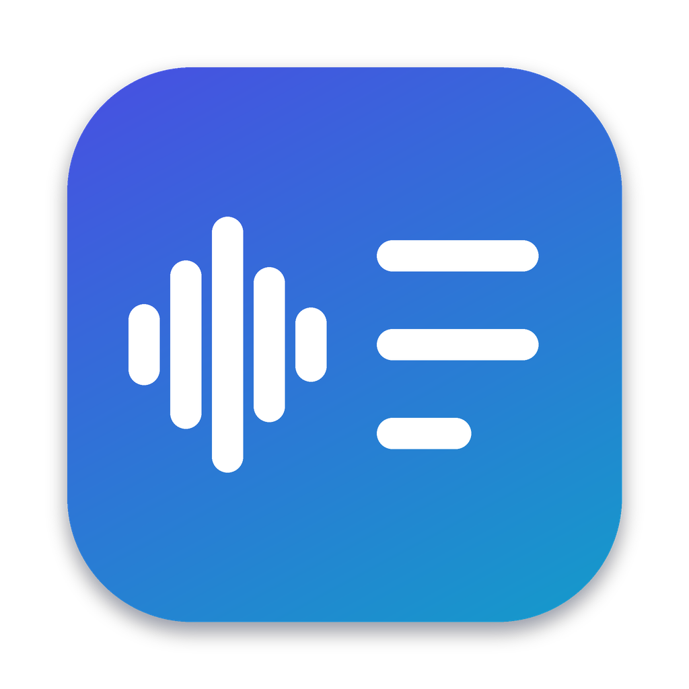

# Transskriber

**Fra lydfil til Word-dokument på dansk, direkte på din Mac.**

Transskriber gør optagelser af møder, interview og forelæsninger til tekst på dansk. Træk en lydfil ind i vinduet, og kort efter åbner et færdigt Word-dokument. Al behandling sker lokalt på din Mac, så lyden forlader aldrig computeren.

<p align="center"></p>

## Funktioner

- **Træk og slip:** Træk en eller flere lydfiler ind i vinduet eller hen på appens ikon. Du kan også vælge dem med knappen.
- **Word-dokument med det samme:** Teksten deles op i afsnit ved de naturlige pauser og gemmes som `.docx` ved siden af lydfilen. Dokumentet åbner af sig selv.
- **Tidsstempler, hvis du vil:** Sæt flueben ved *Tidsstempler*, så starter hvert afsnit med fx **[00:12:45]**. Så er det let at finde stedet i optagelsen.
- **Privat og offline:** Sprogmodellen kører på din Mac. Der kræves ingen konto og intet abonnement, og der sendes ingen lyd nogen steder hen.
- **Arbejder i fred:** Macen holder sig vågen, mens den arbejder, og siger til med en lyd og en notifikation, når den er færdig.
- **Holder sig opdateret:** Kommer der en ny version, viser appen det nederst i vinduet. Den opdaterer kun, når du selv siger ja.

Understøttede formater: MP3, M4A, WAV, AAC, FLAC, OGG, Opus samt lyden fra video i MP4, MOV, M4V og WebM.

## Krav

- En Mac med Apple-chip (M1 eller nyere)
- macOS 13 Ventura eller nyere
- Ca. 3 GB fri plads
- Internet under installationen. Bagefter virker programmet uden internet.

## Installation

1. Hent den nyeste version under [**Releases**](https://github.com/baggi97/transcriber/releases/latest): klik på **Source code (zip)**. Er filen ikke pakket ud af sig selv, så dobbeltklik på den i *Overførsler*.
2. Åbn programmet **Terminal** (find det med Spotlight: tryk ⌘ + mellemrum og skriv *Terminal*).
3. Skriv `bash ` (med et mellemrum efter), træk filen `install.sh` fra den udpakkede mappe ind i Terminal-vinduet, og tryk Enter.
4. Vent til der står **Færdig!**. Første gang tager det et par minutter, fordi sprogmodellen (ca. 1,5 GB) skal hentes.

Programmet ligger nu i mappen *Programmer* i din hjemmemappe (`~/Applications/Transskriber.app`). Træk det ned i Dock'en, så er det nemt at finde.

> Kør installationen uden `sudo`. Den skal ikke have administratoradgang.

## Sådan bruger du det

1. Åbn **Transskriber**.
2. Træk en lydfil ind i vinduet, eller klik på **Vælg lydfil…**.
3. Vent, mens den transskriberer. Statuslinjen viser, hvor længe den har arbejdet.
4. Word-dokumentet åbner af sig selv, når det er færdigt.

Dokumentet får samme navn som lydfilen, fx bliver `møde.mp3` til `møde.docx`. Findes filen i forvejen, bliver den ikke overskrevet, men gemt som `møde (2).docx`. Kan der ikke gemmes i lydfilens mappe, havner dokumentet i *Dokumenter*.

## Opdateringer

Når der er en ny version, står der **Ny version … – Opdater nu** nederst i vinduet. Klik på den for at se, hvad der er nyt, og bekræft. Appen henter opdateringen, installerer den og starter forfra. Går noget galt undervejs, bliver den gamle version ved med at virke.

## Privatliv

Lyden og teksten bliver på din Mac. Programmet bruger kun internettet til at spørge GitHub, om der er en ny version. Det sker, når det starter, og derefter hver 6. time.

## Afinstallere

Vælg **Transskriber → Afinstaller Transskriber…** i menulinjen øverst, og bekræft. Programmet lukker og fjerner programmet, motoren og sprogmodellen. Dine lydfiler og Word-dokumenter bliver ikke rørt. Træk bagefter ikonet ud af Dock'en, hvis det ligger der.

Det samme kan gøres fra Terminal:

```bash
bash "$HOME/Library/Application Support/Transskriber/Afinstaller.command"
```

## Fejlfinding

| Problem | Løsning |
|---------|---------|
| Installationen siger *"Nogle mapper ejes ikke af dig"* | En tidligere installation er kørt med `sudo`. Kør den kommando, installationen viser, og derefter `install.sh` igen. |
| Opdateringen mislykkes | Tjek internetforbindelsen og prøv igen. Detaljerne står i `~/Library/Application Support/Transskriber/update.log`. |
| Transskriberingen mislykkes | Prøv at åbne filen i et andet program for at se, om den virker. Fejlbeskeden kan sendes til den, der har sat programmet op. |

## Teknik

Transskriber bruger OpenAIs talemodel Whisper (`whisper-large-v3-turbo`) via [mlx-whisper](https://github.com/ml-explore/mlx-examples/tree/main/whisper), som udnytter Apple-chippen. Brugerfladen er lavet med Tkinter, og dokumenterne skrives med python-docx. Installationen henter selv Python 3.12 med [uv](https://github.com/astral-sh/uv) og ffmpeg via imageio-ffmpeg, så der skal hverken bruges Homebrew eller administratoradgang.

## Licens

Transskriber er udgivet under [MIT-licensen](LICENSE).

Repoet indeholder kun Transskribers egen kode. Resten hentes fra de officielle kilder (PyPI og Hugging Face) under installationen og er omfattet af sine egne licenser:

| Komponent | Bruges til | Licens |
|-----------|------------|--------|
| [Whisper large-v3-turbo](https://huggingface.co/openai/whisper-large-v3-turbo) fra OpenAI, i [MLX-udgave](https://huggingface.co/mlx-community/whisper-large-v3-turbo) | Sprogmodellen | MIT |
| [mlx-whisper](https://github.com/ml-explore/mlx-examples) og [MLX](https://github.com/ml-explore/mlx) fra Apple | Kører modellen på Apple-chippen | MIT |
| [python-docx](https://github.com/python-openxml/python-docx) | Skriver Word-dokumenterne | MIT |
| [tkinterdnd2](https://github.com/Eliav2/tkinterdnd2) med tkdnd | Træk og slip | MIT (tkdnd: BSD) |
| [huggingface_hub](https://github.com/huggingface/huggingface_hub) | Henter modellen under installationen | Apache 2.0 |
| [imageio-ffmpeg](https://github.com/imageio/imageio-ffmpeg) | Leverer ffmpeg | BSD-2-Clause |
| [FFmpeg](https://ffmpeg.org) | Læser lyd- og videofilerne | GPL v2 eller nyere |
| [Python](https://www.python.org) 3.12 med Tcl/Tk | Kører appen og tegner vinduet | PSF-licensen, Tcl/Tk-licensen (BSD-agtig) |
| [uv](https://github.com/astral-sh/uv) | Installerer Python (kun under installationen) | MIT eller Apache 2.0 |

Øvrige pakker, som motoren trækker med (fx NumPy, SciPy, PyTorch, Numba og tiktoken), er under MIT, BSD, Apache 2.0, MPL 2.0 eller PSF.

FFmpeg kører som et selvstændigt program, som Transskriber kalder. Det er ikke bygget ind i appen, og derfor gælder GPL-licensen kun for FFmpeg selv.

---

Lavet af Rasmus Lolk Andersen.
